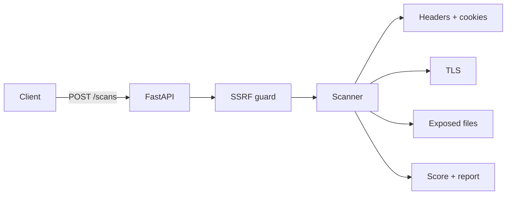

# WebSec Scanner

[](https://github.com/Abdulaziz-Farag/websec-scanner/actions/workflows/ci.yml)


A **passive** web security scanner exposed as an async REST API (FastAPI). Give it a domain, get back a scored
report of misconfigurations: missing security headers, weak cookies, TLS problems, exposed sensitive files.

> **Authorized use only.** Scan only systems you own or have written permission to test.

## What it checks

| Check | Examples |
|---|---|
| Security headers | HSTS, CSP, X-Content-Type-Options, clickjacking protection, Referrer-Policy |
| Information disclosure | `Server` version, `X-Powered-By` |
| Cookies | missing `Secure` / `HttpOnly` / `SameSite` |
| TLS | certificate expiry, verification failures, outdated protocol |
| Exposed files | `/.git/HEAD`, `/.env`, `phpinfo.php`, `/server-status` (content-validated to avoid false positives) |
| Disclosure policy | `/.well-known/security.txt` (RFC 9116) |

Each scan returns findings sorted by severity and a score out of 100.

## Quick start

```bash
# Docker
WEBSEC_API_KEY=change-me docker compose up --build

# or locally
pip install -r requirements.txt
uvicorn app.main:app --reload
```

```bash
curl -X POST http://localhost:8000/scans \
  -H "X-API-Key: change-me" -H "Content-Type: application/json" \
  -d '{"target": "example.com"}'
```

Open `http://localhost:8000/docs` for the interactive OpenAPI UI, and `GET /scans/{id}/report` for the HTML report.

## Architecture



## Design decisions

- **SSRF guard.** The target is resolved and rejected unless *every* address is globally routable
  (no loopback, RFC1918, link-local/cloud-metadata). Redirects are followed manually and each hop is re-validated.
- **Passive by design.** Only GET requests to a small fixed list of paths; no fuzzing, no exploitation.
- **Low false positives.** Probes validate the response body (e.g. `.git/HEAD` must start with `ref:`) instead of trusting a 200 status.
- **Bounded reads.** At most 2 KB of any response is read; concurrency is capped.
- **Safe reporting.** Headers come from the scanned site, so the HTML report escapes every value (covered by a test).
- **API key auth** with constant-time comparison (`WEBSEC_API_KEY`; disabled when unset for local dev).
- **Hardened container.** Non-root user, read-only filesystem, all capabilities dropped.

## Development

```bash
pip install -r requirements-dev.txt
ruff check . && pytest
```

## Known limitations

- DNS is validated, then resolved again by the HTTP client, so a DNS-rebinding race is theoretically possible. Pinning the resolved IP is on the roadmap.
- Scan results live in memory (last 200).

## Roadmap

- [ ] PostgreSQL persistence + background job queue
- [ ] JWT auth and per-key rate limiting
- [ ] Dangling-CNAME / subdomain takeover detection
- [ ] SARIF / JSON export for CI pipelines
- [ ] Pin resolved IP per request

## License

MIT
